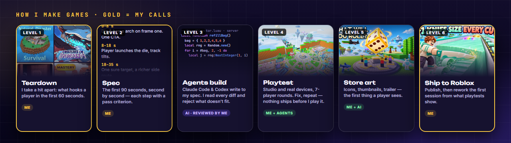
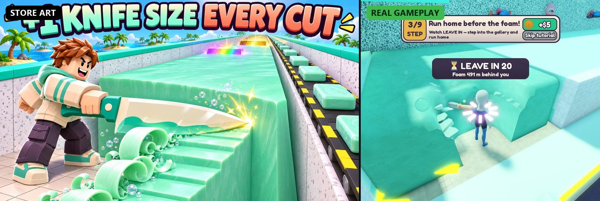
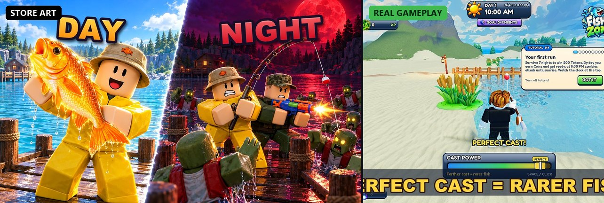
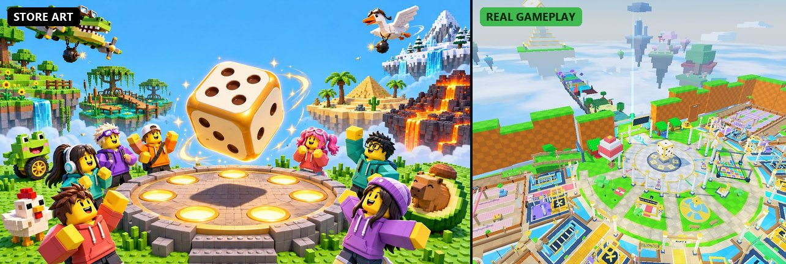
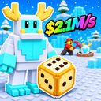
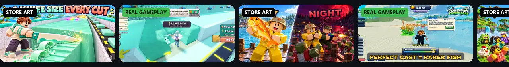

  
  
  
  

**Hire one person. Get a studio.** I design Roblox games, direct a crew of AI agents (Claude Code, Codex) like a dev team, review every line and playtest every build — and ship. 13,000+ Luau lessons taught me to read other people's code, so *I* decide what agent code gets in. **Open to remote, full-time roles.**

## 🎲 How I make games

Every level has a real artifact: a teardown, a second-by-second spec of the first 90 seconds, server code like [`RoundDirector.luau`](https://condrusarsen.github.io/condrus/#studio), playtest frames, store art and a shipped game. **Gold cards are my calls.**

## 🗂️ Case files — decisions, not vanity stats

<table>
  <tr>
    <td width="33%" valign="top">
      
      &nbsp;<b>+1&nbsp;Knife&nbsp;Size Every&nbsp;Cut</b> 
      &nbsp;🟢 <b>SHIPPED · SOLO</b> — concept to launch
      <ul>
        <li>One verb, visible growth: every cut makes the knife bigger.</li>
        <li>A foam wave turns a calm loop into a run home.</li>
        <li>Rebuilt the first session after playtests.</li>
      </ul>
      <a href="https://www.roblox.com/games/102709455340707"><b>▶ Play on Roblox</b></a>
    </td>
    <td width="33%" valign="top">
      
      &nbsp;<b>Fish&nbsp;&amp;&nbsp;Survive: Zombie&nbsp;Lake</b> 
      &nbsp;🔵 <b>CO-DEV · IN DEVELOPMENT</b> — UI, map, systems
      <ul>
        <li>Day fishing feeds night defence: one economy, two moods.</li>
        <li>Lobby ↔ match teleports with reserved servers.</li>
        <li>Session-locked shared saves, so progress never forks.</li>
      </ul>
      <a href="https://www.roblox.com/games/134519178428493"><b>▶ Play on Roblox</b></a>
    </td>
    <td width="33%" valign="top">
      
      &nbsp;<b>Dice&nbsp;&amp;&nbsp;Dash: Roll&nbsp;the&nbsp;World</b> 
      &nbsp;🟡 <b>NEW CORE · IN DEVELOPMENT</b> — design &amp; direction
      <ul>
        <li>The server owns the roll; the client only plays the die.</li>
        <li>Shuffle bag: the same face never comes up twice in a row.</li>
        <li>Spec rule: the player acts within 8 seconds of joining.</li>
      </ul>
      The live version is a reworked purchased template; the new dice core is in development.
    </td>
  </tr>
</table>

<b>100+</b> playable prototypes (<a href="https://condrusarsen.github.io/ai-game-lab/">83 public</a>) &nbsp;·&nbsp; <b>600+</b> game teardowns (69 published) &nbsp;·&nbsp; <b>13,000+</b> Luau lessons taught &nbsp;·&nbsp; <b>6+ years</b> with Roblox Studio

## 🧰 The craft

- **Roblox gameplay & systems** — Luau, RemoteEvents, DataStore/ProfileStore, TeleportService, reserved servers, NPCs, UI. Hand-written Luau: [Roblox Feature Pack](https://github.com/CondrusArsen/roblox-feature-pack) (2025) and NPC behaviour in [Arcane Orchard](https://github.com/CondrusArsen/arcane-orchard-rpg).
- **Directing AI agents** — specs, review, rejection, playtests. Code from 2026 is written by agents under my direction; architecture and the final call are mine.
- **Game design** — core loops, first session, progression and economy. See the [Match-3 case study](https://github.com/CondrusArsen/match3-game-design-case-study).
- **Tools** — a [Telegram AI agent](https://github.com/CondrusArsen/ai-agent-demo) with tool calling and RAG, [HTML5 playable ads](https://github.com/CondrusArsen/playable-ads-demo).

  
  
  
  
  
  
  
  

## 💼 Experience

- **2025 – now · Roblox Developer**, Zombie Lake Games — own and co-developed Roblox games (above).
- **Jul – Oct 2026 · Game Designer & AI Prototyper**, independent game studio (contract) — game research, prototype specs, AI-assisted builds, playtests and QA.
- **2021 – 2026 · UI/UX Designer**, freelance — mobile game and app interfaces in Figma.
- **Dec 2019 – Jul 2026 · Roblox Studio & Luau Instructor**, Itgenio — 13,000+ lessons: gameplay systems, data, NPCs, live debugging.
- **Mathematics**, Francisk Skorina Gomel State University, 2017 – 2021.

## 📄 CV

[Roblox Developer · RU](cv/Atrokhov_Arseniy_Roblox_RU.pdf) · [Game Prototyper · EN](cv/Arseni_Atrokhov_Game_Prototyper_EN.pdf) · [Game Design · RU](cv/Atrokhov_Arseniy_Game_Design_RU.pdf) · [AI Tools · RU](cv/Atrokhov_Arseniy_AI_Tools_RU.pdf)

## ✉️ Contact

Gomel, Belarus (UTC+3) · remote, full-time · Russian native, English (written).
**Telegram [@qintin](https://t.me/qintin)** · [LinkedIn](https://www.linkedin.com/in/arseni-atrokhov/) · [Condrus Studio — open my computer](https://condrusarsen.github.io/condrus/)
