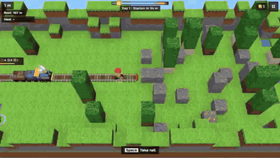
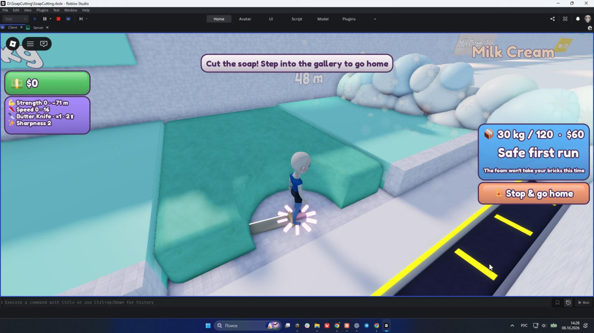
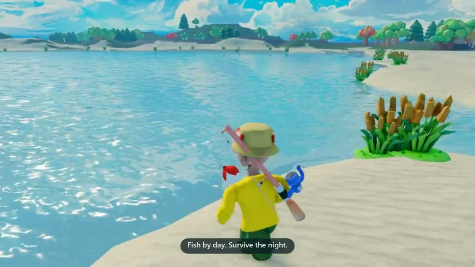
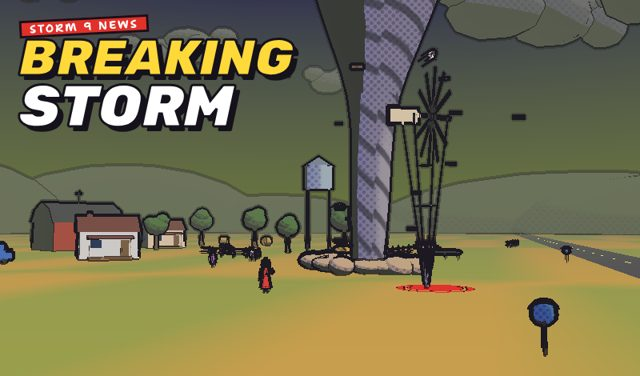
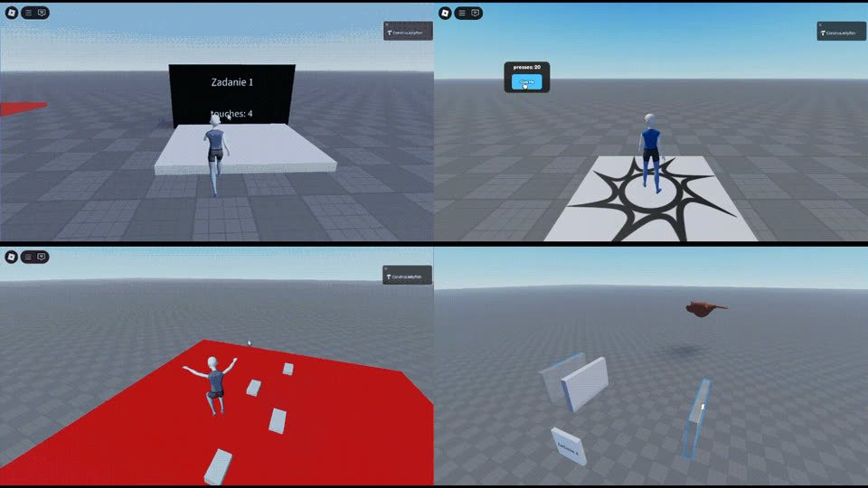

# Arseni Atrokhov

**Roblox Developer & Game Prototyper · Luau · HTML5**

**[Watch the 35-second showreel](https://condrusarsen.github.io/ai-game-lab/?lang=en&v=aae7f9c)** · [3D market](https://condrusarsen.github.io/ai-game-lab/market.html) · [Full catalogue](https://condrusarsen.github.io/ai-game-lab/list/) · [CV and contact](#cv-and-contact)

## Selected work

<table>
  <tr>
    <td width="50%">
      
      <strong>SoapCutting</strong> · My published Roblox game 
      I designed the cutting loop, progression and UI, directed implementation with AI coding tools, and playtested the build. The image shows an early Studio playtest. 
      <a href="https://www.roblox.com/games/102709455340707">Play on Roblox</a> · <a href="https://github.com/CondrusArsen/CondrusArsen/tree/main/projects/soap-cutting">Development case</a>
    </td>
    <td width="50%">
      
      <strong>Fish &amp; Survive: Zombie Lake</strong> · Collaborative Roblox game 
      I worked on the UI, map, client/server scripts and shared mechanics. The game has separate lobby and match places, reserved servers and shared progression. 
      <a href="projects/zombie-lake/README.md">Development case</a> · <a href="https://www.roblox.com/games/134519178428493">Play on Roblox</a> · <a href="https://condrusarsen.github.io/ai-game-lab/showreel/zombie-lake.mp4">Watch the trailer</a>
    </td>
  </tr>
  <tr>
    <td width="50%">
      
      <strong>Breaking Storm Live</strong> · HTML5 prototype 
      I designed a game around framing a live weather report and directed its implementation and playtests. 
      <a href="https://condrusarsen.github.io/ai-game-lab/games/breaking-storm/">Play in browser</a>
    </td>
    <td width="50%">
      
      <strong>Roblox Feature Pack</strong> · Luau systems 
      I wrote the original 2025 Luau code and later directed a refactor with server validation, persistent state, Rojo and automated checks. 
      <a href="https://github.com/CondrusArsen/roblox-feature-pack">Code and recordings</a> · <a href="https://github.com/CondrusArsen/roblox-feature-pack/tree/original-2025">Original Luau</a>
    </td>
  </tr>
</table>

## Design and automation

- [Match-3 design case](https://github.com/CondrusArsen/match3-game-design-case-study) · Early-game comparison, obstacle specification and collection-event concept.
- [Playable ads](https://github.com/CondrusArsen/playable-ads-demo) · Two HTML5 demos, with source and playable builds.
- [AI Agent Demo](https://github.com/CondrusArsen/ai-agent-demo) · Local Telegram agent for catalogue checks, order intake and knowledge-base search. [Browser walkthrough](https://condrusarsen.github.io/ai-game-lab/?focus=tools&lang=en).
- [School Journal Bot](https://github.com/CondrusArsen/school-journal-bot) · Python, aiogram and SQLite, with grade-entry, reports and Excel export.
- [Arcane Orchard](https://github.com/CondrusArsen/arcane-orchard-rpg) · Collaborative Roblox RPG prototype. I wrote the original NPC behaviour and later directed its refactor.
- [Game UI case](https://condrusarsen.github.io/game-ui-case/) · Interactive UI prototype. Paid Figma work includes a [mobile quiz](https://github.com/CondrusArsen/among-us-story-mobile-quiz-ui) and [mobile game UI](https://github.com/CondrusArsen/blackjack-mobile-game-ui).

## Experience

**Jul–Oct 2026 · Studio contract** — game research, prototype specs, AI-assisted browser builds and QA.

**Dec 2019–Jul 2026 · Itgenio** — Roblox Studio and Luau instruction, including live debugging and player onboarding.

**2021–2026 · Freelance UI/UX** — paid mobile game and app interfaces in Figma.

**Education** — Mathematics, Francisk Skorina Gomel State University, 2017–2021.

## CV and contact

[Roblox / game prototyping · RU](https://github.com/CondrusArsen/CondrusArsen/blob/main/cv/Atrokhov_Arseniy_Roblox_RU.pdf) · [Game prototyping · EN](https://github.com/CondrusArsen/CondrusArsen/blob/main/cv/Arseni_Atrokhov_Game_Prototyper_EN.pdf) · [Game design · RU](https://github.com/CondrusArsen/CondrusArsen/blob/main/cv/Atrokhov_Arseniy_Game_Design_RU.pdf) · [AI tools · RU](https://github.com/CondrusArsen/CondrusArsen/blob/main/cv/Atrokhov_Arseniy_AI_Tools_RU.pdf)

Gomel, Belarus (UTC+3) · Remote, full-time · Russian native, elementary English.

[LinkedIn](https://www.linkedin.com/in/arseni-atrokhov/) · Telegram **@qintin**
