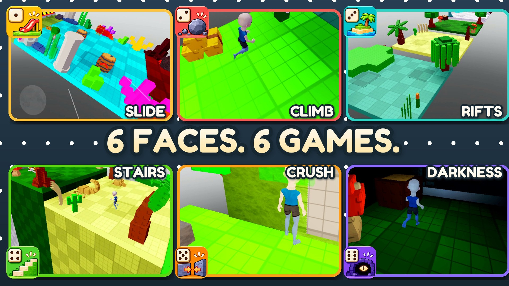
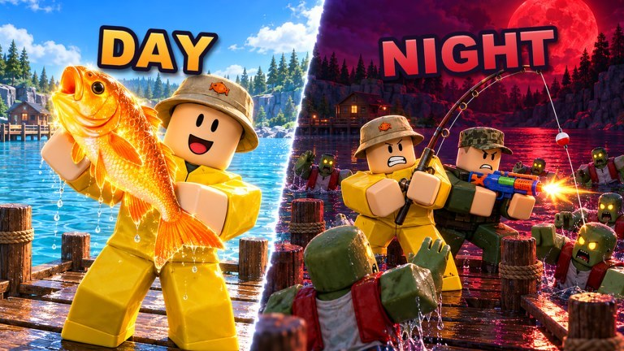
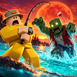
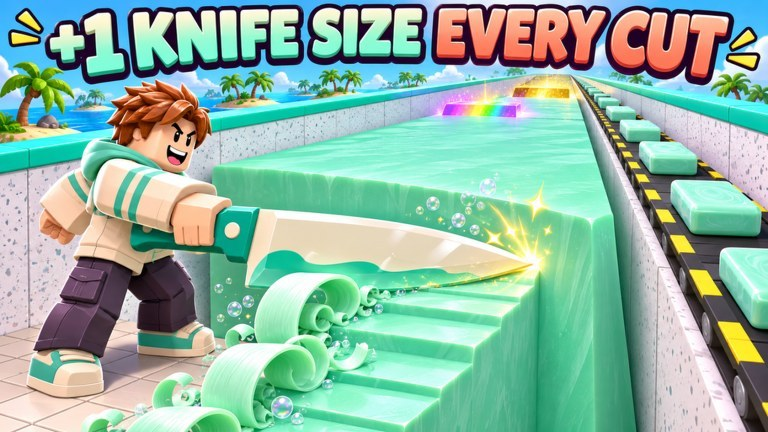
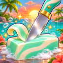
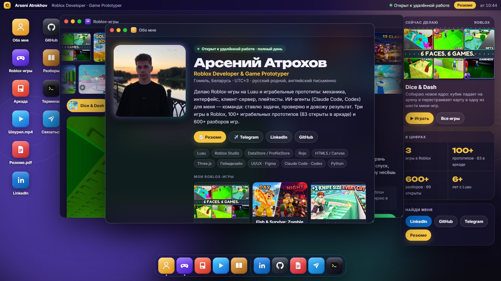

  
  
  
  

I build **Roblox games in Luau** and **playable prototypes**: mechanics, UI, client/server systems and playtests. AI agents (Claude Code, Codex) are my team — I set the tasks, review every build and ship the result. **Open to remote, full-time roles.**

## 🎮 My Roblox games

<table>
  <tr>
    <td width="33%" valign="top">
      
      &nbsp;<b>Dice&nbsp;&amp;&nbsp;Dash</b> 
      &nbsp;Live since 12 Nov 2026 · new core in development
      
A giant die lands on the arena and the rolled face rebuilds the map into one of six mini-games. The live version is a reworked purchased template; I'm building the new core in Studio with AI agents.

      <a href="https://www.roblox.com/games/70861231474704"><b>▶ Play</b></a>
    </td>
    <td width="33%" valign="top">
      
      &nbsp;<b>Fish&nbsp;&amp;&nbsp;Survive: Zombie&nbsp;Lake</b> 
      &nbsp;Co-developed · in active development
      
Fish by day, survive the zombie night. I built the UI, map, client/server scripts, place teleports and session-locked shared saves.

      <a href="https://www.roblox.com/games/134519178428493"><b>▶ Play</b></a>
    </td>
    <td width="33%" valign="top">
      
      &nbsp;<b>+1&nbsp;Knife&nbsp;Size Every&nbsp;Cut</b> 
      &nbsp;My own game · live · onboarding rework
      
Every cut makes the knife bigger. From concept to launch: core loop, progression, UI, AI-assisted build and playtests.

      <a href="https://www.roblox.com/games/102709455340707"><b>▶ Play</b></a>
    </td>
  </tr>
</table>

## 🖥️ Open my computer

My portfolio is a small operating system: Roblox games with trailers, an arcade where browser games play right in a window, my CVs, code and contacts — each opens as an app.

<b>3</b> Roblox games &nbsp;·&nbsp; <b>100+</b> playable prototypes (<a href="https://condrusarsen.github.io/ai-game-lab/">83 public</a>) &nbsp;·&nbsp; <b>600+</b> game teardowns (69 published) &nbsp;·&nbsp; <b>6+ years</b> with Roblox Studio &amp; Luau

## 🧰 What I do

- **Roblox gameplay & systems** — Luau, RemoteEvents, DataStore/ProfileStore, TeleportService, reserved servers, NPCs, UI. Hand-written Luau: [Roblox Feature Pack](https://github.com/CondrusArsen/roblox-feature-pack) (2025) and NPC behaviour in [Arcane Orchard](https://github.com/CondrusArsen/arcane-orchard-rpg).
- **Fast prototyping with AI agents** — from a teardown to a playable build in days; I own the design decisions and test every build on phone and desktop.
- **Game design** — core loops, first-session experience, progression and economy. See the [Match-3 case study](https://github.com/CondrusArsen/match3-game-design-case-study).
- **Tools & automation** — a [Telegram AI agent](https://github.com/CondrusArsen/ai-agent-demo) with tool calling and RAG, [HTML5 playable ads](https://github.com/CondrusArsen/playable-ads-demo).

  
  
  
  
  
  
  
  

## 💼 Experience

- **Jul–Oct 2026 · Game Designer & AI Prototyper**, independent game studio (contract) — game research, prototype specs, AI-assisted browser builds, playtests and QA.
- **2021–2026 · UI/UX Designer**, freelance — paid mobile game and app interfaces in Figma.
- **Dec 2019–Jul 2026 · Roblox Studio & Luau Instructor**, Itgenio — 13,000+ lessons: gameplay systems, data, NPCs, live debugging.
- **Mathematics**, Francisk Skorina Gomel State University, 2017–2021.

## 📄 CV 

[Roblox Developer · RU](cv/Atrokhov_Arseniy_Roblox_RU.pdf) · [Game Prototyper · EN](cv/Arseni_Atrokhov_Game_Prototyper_EN.pdf) · [Game Design · RU](cv/Atrokhov_Arseniy_Game_Design_RU.pdf) · [AI Tools · RU](cv/Atrokhov_Arseniy_AI_Tools_RU.pdf)

## ✉️ Contact

Gomel, Belarus (UTC+3) · remote, full-time · Russian native, English elementary (written).
**Telegram [@qintin](https://t.me/qintin)** · [LinkedIn](https://www.linkedin.com/in/arseni-atrokhov/) · [Portfolio](https://condrusarsen.github.io/condrus/)
