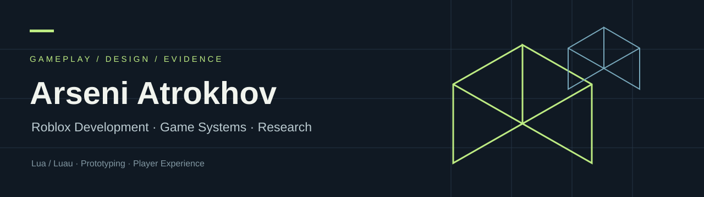

I turn game ideas and research findings into clear rules, playable systems and testable prototypes. My main focus is **Roblox Studio and Lua/Luau**, with experience across game research, UX, testing and development.

[LinkedIn](https://www.linkedin.com/in/arseni-atrokhov/) · **Gomel, Belarus** · Open to remote roles and local opportunities in Gomel

## Start here

**[Deep Contract — Research to Playable Game](https://github.com/CondrusArsen/deep-contract)** connects a detailed gameplay teardown with a mining-management and tower-defence prototype. Review the playable game, TypeScript source, design notes, tests and preserved publication packages in one place.

**[Play](https://condrusarsen.github.io/deep-contract/) · [Game & teardown downloads](https://github.com/CondrusArsen/deep-contract/releases/tag/v1.0.0) · [My role and implementation](https://github.com/CondrusArsen/deep-contract#project-work)**

## More projects

These repositories document my earlier Roblox, software and design work. They include source code, screenshots or design documents and describe their individual scope.

| Project | What is available |
|---|---|
| [Arcane Orchard RPG](https://github.com/CondrusArsen/arcane-orchard-rpg) | A learning project built with a student: magic combat, NPCs, resource loops and a shop. Extracted Luau and a Studio place via Git LFS; prototype limitations apply. |
| [Roblox Feature Pack](https://github.com/CondrusArsen/roblox-feature-pack) | An earlier test assignment: platform triggers, teleports, checkpoints, GUI events and animation. Original Studio file and gameplay GIFs. |
| [School Journal Bot](https://github.com/CondrusArsen/school-journal-bot) | Python, aiogram and SQLite: classes, students, grade entry, template-based reports and Excel export. |
| [Match-3 Design Case Study](https://github.com/CondrusArsen/match3-game-design-case-study) | Comparative gameplay analysis, a layered obstacle concept and a collection-event proposal. |
| [Mobile Quiz UI](https://github.com/CondrusArsen/among-us-story-mobile-quiz-ui) | An unofficial Figma learning concept: quiz flow, lives, results and shop screens. |
| [Number-Guessing Game UI](https://github.com/CondrusArsen/blackjack-mobile-game-ui) | A casino-themed Figma interface concept using number guessing rather than traditional Blackjack rules. |
| [Mini Movie Journal](https://github.com/CondrusArsen/film-catalog-frontend) | A small Vanilla JavaScript learning project: search, filters, details pages and theme switching. |

## What I bring

- **Gameplay implementation:** client/server logic, RemoteEvents, UI states, inventories, shops, progression, NPC behavior and saved data in Roblox projects.
- **Game design and research:** core loops, rewards, onboarding, competitor analysis, mechanic breakdowns and practical proposals for developers.
- **Testing and iteration:** reproduction steps, expected vs actual behavior, playtesting and feedback that can become a concrete fix.
- **UX thinking:** player flows, navigation and interface feedback, supported by Figma experience.

## Background

**Bloom Labs · Game design, research & prototyping · Jul–Oct 2026**  
Worked across game analysis, QA, product feedback and browser-game prototyping. Helped connect gameplay evidence, structured specifications, implementation and iteration in a small team.

**Itgenio · Programming & game-development instructor · Dec 2019–Jul 2026**  
Delivered **13,000+ online lessons**. Guided projects from idea to implementation, debugged unfamiliar code and explained gameplay systems to learners. This is part of my technical foundation; my current job search focuses on development and game design.

**UI/UX · Freelance and self-directed projects · 2021–Jul 2026**  
Designed mobile and game-interface concepts, flows and prototypes in Figma.

## In development

**A separate Roblox game is in progress.** Its public case study will be added after the gameplay, optimization and presentation are ready. It is not included in the completed-project list yet.

Interested in Roblox development, technical game design, gameplay prototyping or game research? [Contact me on LinkedIn](https://www.linkedin.com/in/arseni-atrokhov/).
