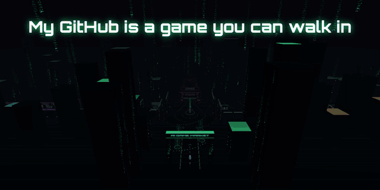

  &nbsp;&nbsp;
  

<b>My portfolio is a game you can walk in.</b> 83 games playable in the browser · 69 game teardowns, 17 of them Roblox hits · Roblox projects, a match-3 design case and a Figma wall of client UI. Works on desktop and phone: walk with WASD or tap the floor, <code>M</code> opens the map and search.

---

## Arseni Atrokhov — AI-assisted Game Developer · Roblox (Luau) · HTML5 · Game Design

I turn a game idea into a playable, tested build quickly, and I can tell what makes a game work. I use Claude, Codex and Gemini as my production team: I make the design decisions, direct the agents, review the results and own the final quality.

**What I can do for your team**

- 🎮 **Ship playable prototypes fast.** I take a concept to a browser or Roblox build your team can playtest. I've built 100+ playable games and prototypes (HTML5 and Roblox) with AI agents; 83 of them are [playable in my market](https://condrusarsen.github.io/ai-game-lab/).
- 🔬 **Research games and markets.** I've analysed 600+ games (Roblox, web, indie/Steam, mobile): core loop, FTUE, economy, monetization, retention. I can tell you what to copy, what to change and why.
- 🛠 **Build AI tools for the pipeline.** I made tools that turn gameplay videos into evidence-based teardowns at scale (a Gemini Chrome extension and Codex skills).
- 🧱 **Roblox and Luau.** 6.5 years with Roblox Studio: systems, client/server logic, saving, NPCs, UI, and debugging other people's code.

📍 Remote · Gomel, Belarus (UTC+3) · Open to full-time roles and project work — [services & prices (RU)](https://condrusarsen.github.io/services/) · English: elementary — I read English and write with translation tools, which works well in async, text-based teams · [LinkedIn](https://www.linkedin.com/in/arseni-atrokhov/)

---

### ⭐ Featured

**[AI Game Market](https://github.com/CondrusArsen/ai-game-lab)** — the 3D market above: 26 games in the main rows, 57 more prototypes in the Vault, 69 teardowns. Built with AI agents, solo and in a small team. **[▶ Walk in](https://condrusarsen.github.io/ai-game-lab/)**

**[Deep Contract](https://github.com/CondrusArsen/deep-contract)** — mining management + tower defence: day/night loop, worker AI, waves and bosses, upgrade tree. TypeScript, 36 tests, full design notes. **[▶ Play](https://condrusarsen.github.io/deep-contract/)**

**[Playable Ads demos](https://github.com/CondrusArsen/playable-ads-demo)** — three HTML5 playable ads (pin-puzzle with fluid physics, crowd runner, merge battler on PixiJS 8), single-file with MRAID 2.0 structure, plus a Telegram Mini App game. **[▶ Play](https://condrusarsen.github.io/playable-ads-demo/)**

**[Lumen Tides — game UI/UX case](https://condrusarsen.github.io/game-ui-case/)** — interactive mobile game interface: home with events, level map, booster sheet, victory, shop with offers and purchase flow, battle pass; screen transitions and 25+ micro-animations. Made with AI. **[▶ Try it](https://condrusarsen.github.io/game-ui-case/app.html)**

### 🧱 Roblox

| Project | What it shows |
|---|---|
| [Arcane Orchard RPG](https://github.com/CondrusArsen/arcane-orchard-rpg) | Magic combat, NPC AI with pathfinding, economy and shop. Started with a student; refactored with AI agents under my direction (Rojo, server-authoritative purchases, safe DataStore saves, CI) and playtested in Studio |
| [Roblox Feature Pack](https://github.com/CondrusArsen/roblox-feature-pack) | Studio test assignment: triggers, teleports, per-player checkpoints, GUI + RemoteEvents, DataStore, animation |

### 📐 Game design

| Project | What it shows |
|---|---|
| [Match-3 Design Case Study](https://github.com/CondrusArsen/match3-game-design-case-study) | Early-game analysis of 200 levels per title, a layered obstacle mechanic, a collection event |
| [69 game teardowns](https://condrusarsen.github.io/ai-game-lab/list/) | Evidence-based breakdowns: core loop, economy, progression, FTUE, monetization |

### 🛠 Other

[School Journal Bot](https://github.com/CondrusArsen/school-journal-bot) (Python, aiogram, SQLite, 18 tests)

---

### Experience

**Bloom Labs** — Game Designer & AI Prototyper (contract) · Jul–Oct 2026
Researched 600+ games and built AI tools that automate teardowns. Built playable web games and prototypes with AI agents. Ran competitor and economy analysis, redesigned the core loop and did release QA for a live Roblox game.

**Itgenio** — Roblox & game-development instructor · 2019–2026
13,000+ online sessions: Roblox Studio, Lua/Luau, game systems. Daily debugging of unfamiliar code.

**Freelance** — UI/UX for mobile games and apps in Figma, paid client work · 2021–2026

### Toolbox

`Luau` `Roblox Studio` `JavaScript` `HTML5 Canvas` `Claude Code` `Codex` `Gemini` `Figma` `Git`

**Looking for:** AI game designer / AI prototyper · Roblox developer · game designer (casual, Roblox) · HTML5 game developer — remote. **[Message me on LinkedIn](https://www.linkedin.com/in/arseni-atrokhov/)**
