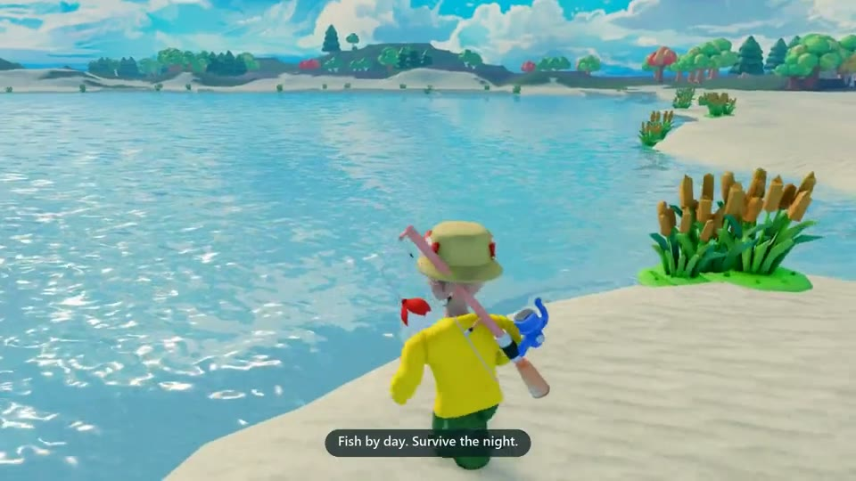
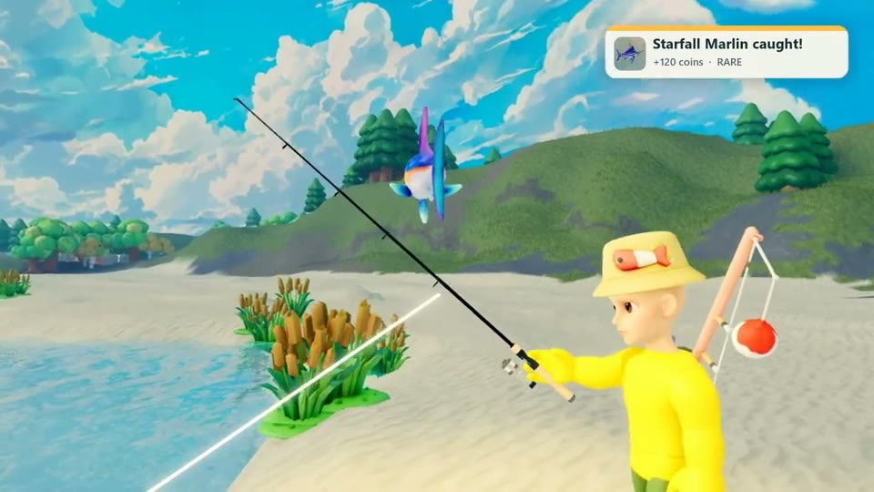
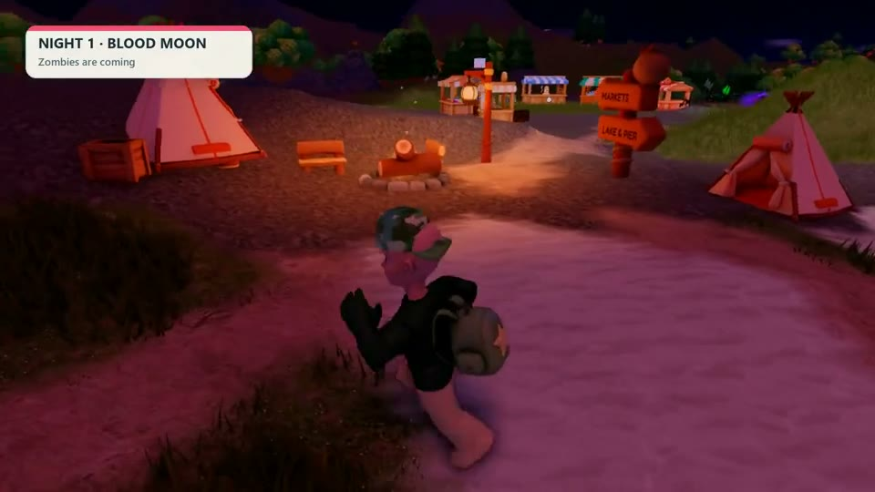
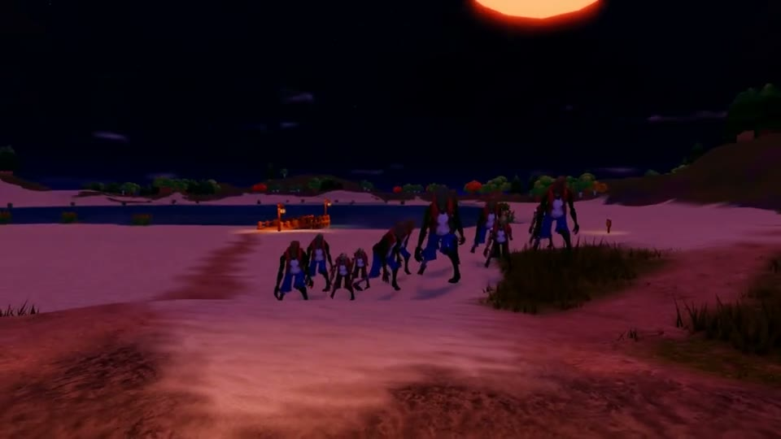
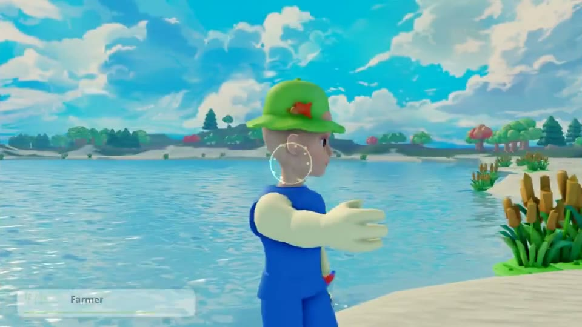

# Fish & Survive: Zombie Lake

**A collaborative Roblox survival game in active development.** Fish by day, then defend against zombies at night. The game has character classes, progression, and separate lobby and match places.

**[Watch the 30-second gameplay trailer](https://condrusarsen.github.io/ai-game-lab/showreel/zombie-lake.mp4)** · [Open on Roblox](https://www.roblox.com/games/134519178428493) · [Developer profile](../../README.md)

## My contribution

I’m developing Zombie Lake with a teammate. I worked on client and server scripts in Luau with AI coding tools, redesigned parts of the UI, populated the map, and guided the creation of models used in the game. My teammate and I developed gameplay mechanics together, and I helped refine them as the project evolved.

| Area | What I did |
| --- | --- |
| Luau | Worked on scripts on both sides of Roblox’s client/server boundary. |
| UI | Redesigned parts of the player-facing interface. |
| Map and models | Populated the map and guided model creation. |
| Gameplay | Developed and refined mechanics with my teammate. |

The shared project uses reserved servers, teleport retries, and shared progression across the lobby and match.

## Gameplay frames

These frames come from the gameplay trailer. They show the shared project in action.

| Daytime fishing · 0:08 | First night · 0:11 |
| --- | --- |
|  |  |
| The catch notification shows the fish, rarity and coin reward. | The Blood Moon warning marks the change from fishing to survival. |

| Zombie wave · 0:16 | Character class · 0:23 |
| --- | --- |
|  |  |
| The shoreline during a night wave. | The Farmer in the trailer’s class showcase. |

## More Roblox work

The Zombie Lake source is private. For a public Luau sample, see the [Roblox Feature Pack](https://github.com/CondrusArsen/roblox-feature-pack/tree/original-2025). [SoapCutting](../soap-cutting/README.md) shows a solo Roblox project I took from concept to publication.

[English CV](../../cv/Arseni_Atrokhov_Game_Prototyper_EN.pdf) · [Contact on LinkedIn](https://www.linkedin.com/in/arseni-atrokhov/)
